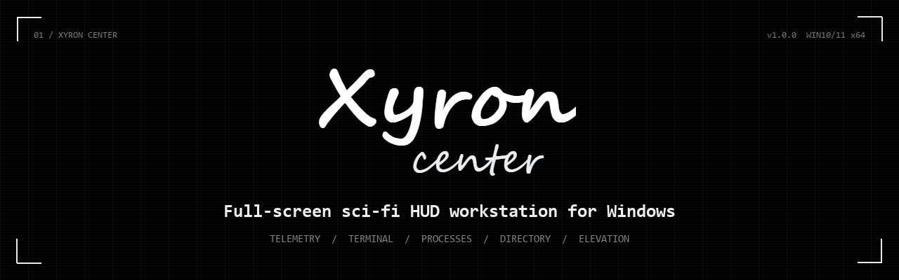
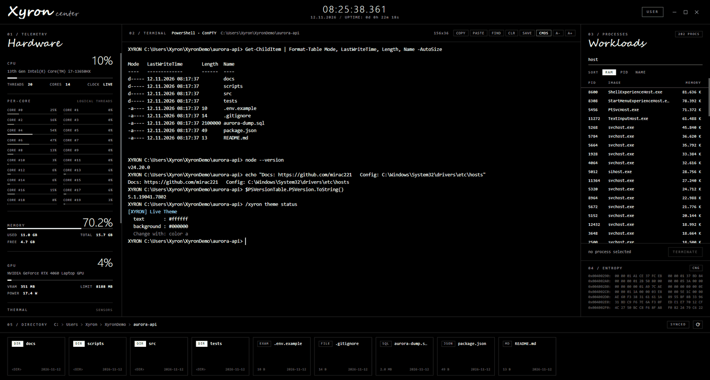
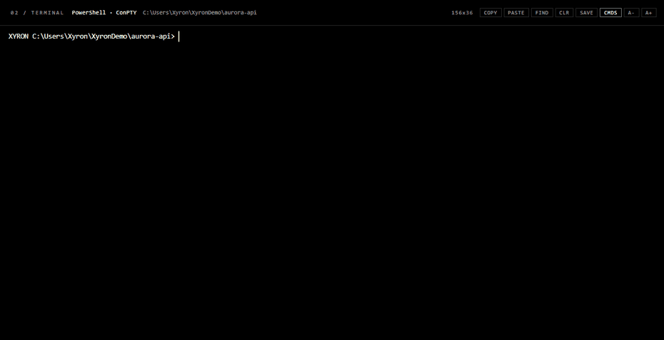
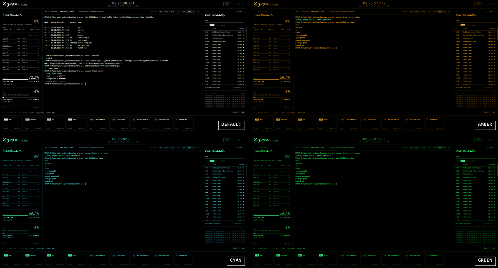
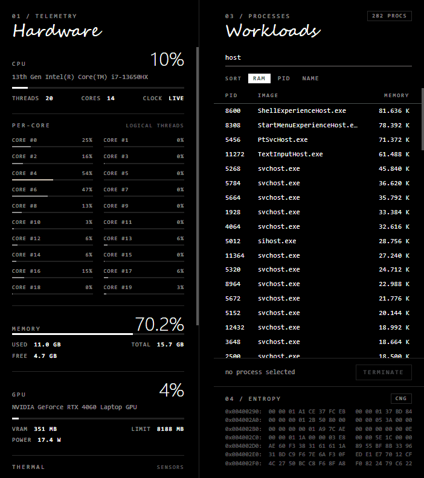
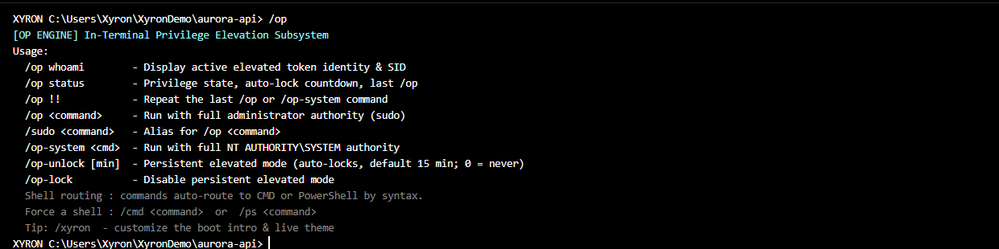
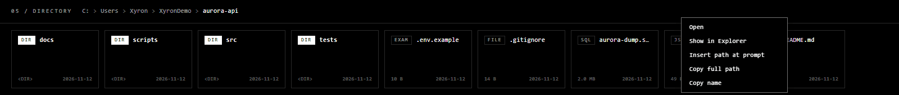
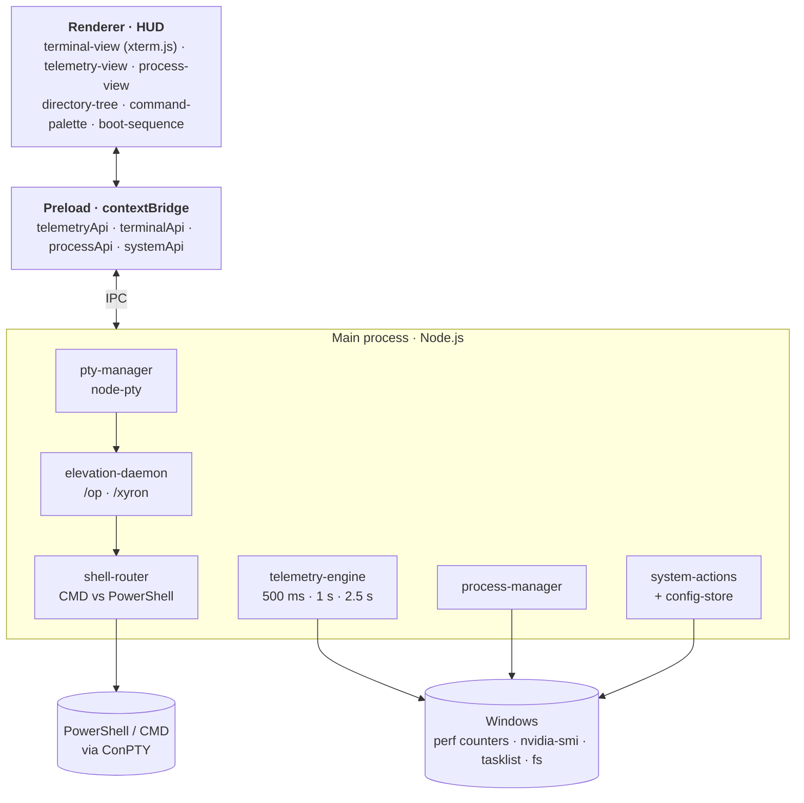

<div align="center">



<br />

**A full-screen, sci-fi HUD that puts a real terminal, live hardware telemetry, a process manager<br />and a synced file browser on one black screen.**

<br />

<a href="../../releases/latest"></a>
<a href="#quick-start"></a>

<br /><br />


<br /><br />

[Features](#features) ·
[Screenshots](#screenshots) ·
[Who it's for](#who-its-for) ·
[Quick start](#quick-start) ·
[Usage](#usage) ·
[Architecture](#architecture) ·
[Security](#security-model) ·
[Roadmap](#roadmap) ·
[Developers](#developers)

</div>

<br />



<br />

## Why Xyron Center?

Most of the time you are juggling a terminal, Task Manager, File Explorer and a hardware monitor, each in its own window and each with its own look. Xyron Center puts all four on one distraction-free screen built around the terminal:

- **The terminal is the center of gravity.** It is a real Windows ConPTY session (PowerShell or CMD), not a toy emulator. Everything else reacts to it: the directory panel follows your `cd`, links in the output are clickable, and files dragged in become quoted paths.
- **Everything is live, nothing is mocked.** CPU ticks, RAM, GPU (via `nvidia-smi`), drives, network throughput and processes come from the OS on a three-tier polling loop.
- **Admin work without the window ping-pong.** `/op <command>` runs a single command with administrator rights, `/op-system` runs it as `NT AUTHORITY\SYSTEM`, and the result appears in the same terminal.
- **One look, fully yours.** Pure black and white by default, one command to switch to amber, green, cyan or any hex color, plus a short handwritten intro on every launch.

<br />

## Features

<table>
<tr>
<td width="50%" valign="top">

### Terminal
- Native **ConPTY** shell (PowerShell 5.1 or CMD) rendered with **xterm.js**, with UTF-8 (`chcp 65001`) by default
- **Smart shell router**: each command goes to CMD or PowerShell based on its syntax. Force one with `/cmd …` or `/ps …`
- **Command palette** (`Ctrl+Shift+P`): searchable actions, ready-made diagnostics and theme presets
- **Clickable links**: `Ctrl+click` opens URLs in your browser and shows `C:\…` paths in Explorer (`file.js:12:5` suffixes included)
- **Drag & drop**: files from Explorer or the directory panel are typed in as safely quoted paths
- **Save log** (`Ctrl+Shift+S`): exports the whole scrollback as a UTF-8 text file
- Copy, paste, find, clear and zoom controls in the header, plus the CMD-style `color` command

</td>
<td width="50%" valign="top">

### Telemetry
- **CPU**: total load, every logical core, model, threads and cores
- **Memory**: used, free and total, with a live gauge
- **GPU**: load, VRAM and power draw (NVIDIA via `nvidia-smi`, with a generic fallback)
- **Thermal**: CPU, GPU, NVMe and board sensors where the hardware exposes them
- **Storage**: used and free space for every drive. Dead network drives can't freeze the app
- **Network**: inbound and outbound throughput with a rolling graph
- **Load warnings**: bars get hatched above 85% and blink above 95%, without breaking the monochrome look

</td>
</tr>
<tr>
<td width="50%" valign="top">

### Processes & directory
- Live **process list** with filter (name or PID) and sort (RAM, PID, name)
- **Terminate** a process together with its whole child tree
- **Directory panel** that follows the terminal's working directory, with breadcrumbs and live `fs.watch` updates
- Double-click a folder to `cd` into it. Double-click a file to open it
- Right-click menu: *Open*, *Show in Explorer*, *Insert path at prompt*, *Copy full path*, *Copy name*
- The last directory is remembered and restored on the next launch

</td>
<td width="50%" valign="top">

### OP engine & customization
- `/op <cmd>`: run one command as administrator, sudo-style
- `/op-system <cmd>`: run one command as `NT AUTHORITY\SYSTEM`
- `/op-unlock [min]`: elevated mode for every command, **locks itself again** after 15 minutes by default
- `/op status`, `/op whoami`, `/op !!` (repeat the last command)
- `/xyron theme …`: live recoloring with presets or any hex color
- `/xyron boot …`: intro on or off, length, logo text, accent color, procedural sound and CRT scanlines

</td>
</tr>
</table>

<br />

## Screenshots

<div align="center">



<sub><b>Command palette:</b> press <code>Ctrl+Shift+P</code>, type a few letters and press Enter. Read-only diagnostics run immediately. Anything that changes the system is only typed at the prompt for you to confirm.</sub>

<br /><br />



<sub><b>Live themes:</b> <code>/xyron theme preset amber</code>, <code>cyan</code>, <code>green</code>, any <code>#hex</code>, or classic <code>color 0a</code>.</sub>

<br /><br />

<table>
<tr>
<td width="40%" align="center" valign="top">
<br />
<sub><b>Telemetry & workloads:</b> per-core load, memory, GPU, and a filterable process list.</sub>
</td>
<td width="60%" align="center" valign="top">
<br />
<sub><b>Signature intro:</b> the logo is written by hand while procedurally generated sound plays. No audio files are shipped. Press <kbd>Esc</kbd> or <kbd>Space</kbd> to skip it.</sub>
<br /><br />
<br />
<sub><b>OP engine:</b> sudo-style elevation inside the same terminal.</sub>
</td>
</tr>
</table>



<sub><b>Directory panel:</b> it follows your <code>cd</code>, and right-clicking a card gives you file actions.</sub>

</div>

<br />

## Who it's for

| You are… | How Xyron Center helps |
|---|---|
| **A developer on Windows** | Terminal, file tree and resource usage stay in view while you build. Compiler output paths are `Ctrl+click`able, and `Ctrl+Shift+S` saves a long build log in one keystroke. |
| **A sysadmin or IT technician** | One-keystroke diagnostics: listening ports with their owning process, top CPU/RAM consumers, services, startup entries, recent system errors, drive usage, `sfc` / `DISM`. Admin and SYSTEM commands run without opening a new console. |
| **A power user** | A single dashboard instead of Task Manager, Explorer and a sensor tool. Kill runaway process trees, spot a full disk or a hot GPU at a glance. |
| **Someone with a second monitor** | A dedicated, always-on status screen next to your main work. |
| **Streamer or setup enthusiast** | A clean, cinematic monochrome HUD that looks good on camera and can be recolored to match your setup. |

<br />

## Quick start

### Option 1 — Download (recommended)

1. Open the [**latest release**](../../releases/latest) and download `XyronCenter-Portable.exe`.
2. Run it. Windows shows **one** UAC prompt, because Xyron Center needs administrator rights for the OP engine and some telemetry sources.
3. Press <kbd>Esc</kbd> to skip the intro, or let it play.

> [!NOTE]
> The portable EXE is not code-signed yet, so Windows SmartScreen or your antivirus may warn about it. Choose **More info → Run anyway**, or build it yourself from source (below).
> If you decline the UAC prompt, the app still opens in a limited mode where `/op` is unavailable.

### Option 2 — Build from source

**Requirements:** Windows 10 (1809+) or 11, x64 · [Node.js](https://nodejs.org/) 20 or newer · Git

```powershell
git clone https://github.com/Xyronb1/XyronCenter.git
cd XyronCenter
npm install
npm start
```

`node-pty` ships prebuilt binaries, so **no Visual Studio or C++ toolchain is needed**.

| Script | What it does |
|---|---|
| `npm start` | Launch the app in development |
| `npm run test:fast` | Run the core test suites (about 30 s) |
| `npm test` | Run everything, including the long stress suites |
| `npm run build` | Package `win-unpacked\XyronCenter.exe` and `XyronCenter-Portable.exe` into `..\3_Final_EXE_Uygulama` |
| `build-all.bat` | One-click pipeline: install → test → package |

<br />

## Usage

### Keyboard shortcuts

| Shortcut | Action |
|---|---|
| <kbd>Ctrl</kbd> + <kbd>Shift</kbd> + <kbd>P</kbd> | Open / close the command palette |
| <kbd>Ctrl</kbd> + <kbd>Shift</kbd> + <kbd>S</kbd> | Save terminal output to `Documents\XyronCenter\logs` |
| <kbd>Ctrl</kbd> + <kbd>Shift</kbd> + <kbd>F</kbd> | Search the scrollback |
| <kbd>Ctrl</kbd> + <kbd>Shift</kbd> + <kbd>K</kbd> | Clear the scrollback |
| <kbd>Ctrl</kbd> + <kbd>C</kbd> | Copy when text is selected, otherwise interrupt (SIGINT) |
| <kbd>Ctrl</kbd> + <kbd>V</kbd> · <kbd>Shift</kbd> + <kbd>Insert</kbd> | Paste |
| <kbd>Ctrl</kbd> + <kbd>+</kbd> / <kbd>-</kbd> / <kbd>0</kbd> | Bigger / smaller / reset text size |
| <kbd>Ctrl</kbd> + click | Open a URL, or show a path in Explorer |
| <kbd>Esc</kbd> · <kbd>Space</kbd> | Skip the intro |

In the palette: <kbd>↑</kbd> <kbd>↓</kbd> to select, <kbd>Enter</kbd> to run, <kbd>Shift</kbd> + <kbd>Enter</kbd> to insert without running, <kbd>Esc</kbd> to close.

### Built-in commands

<details open>
<summary><b>OP engine</b> — elevation inside the terminal</summary>

| Command | Description |
|---|---|
| `/op <command>` | Run one command with full administrator rights |
| `/op-system <command>` | Run one command as `NT AUTHORITY\SYSTEM` |
| `/op-unlock [minutes]` | Elevate every command until it auto-locks (default 15, `0` = never) |
| `/op-lock` | End elevated mode now |
| `/op status` | Identity, integrity level, auto-lock countdown, last command |
| `/op whoami` | Active token identity and SID |
| `/op !!` | Repeat the last `/op` or `/op-system` command |

The header badge always shows the current security context, e.g. `STANDARD` or `OP`.
</details>

<details>
<summary><b>Theme</b> — recolor the whole HUD live</summary>

| Command | Description |
|---|---|
| `/xyron theme status` | Show the current colors |
| `/xyron theme preset <name>` | `white` · `green` · `amber` · `red` · `cyan` · `magenta` · `blue` · `yellow` |
| `/xyron theme color <#hex>` | Set the text color |
| `/xyron theme bg <#hex>` | Set the background color |
| `/xyron theme reset` | Back to pure black and white |
| `color 0a` · `color f0` · `color #ff8800` | CMD-style color codes (`color ?` lists them) |
</details>

<details>
<summary><b>Boot intro</b> — make the intro yours</summary>

| Command | Description |
|---|---|
| `/xyron boot status` | Show the current intro settings |
| `/xyron boot on` · `off` | Enable / disable the intro |
| `/xyron boot duration <ms>` | Intro length (500–15000 ms) |
| `/xyron boot logo <text>` · `sub <text>` | Logo text and subtitle |
| `/xyron boot color <#hex>` | Accent color |
| `/xyron boot sound on` · `off` | Procedural boot audio |
| `/xyron boot crt on` · `off` | CRT scanline overlay |
| `/xyron boot preview` | Replay the intro now |
| `/xyron boot reset` | Restore defaults |
</details>

<details>
<summary><b>Shell routing</b> — CMD or PowerShell, picked for you</summary>

Commands are classified by syntax and sent to the shell that understands them. To force a shell:

```text
/cmd dir /b *.txt
/ps  Get-ChildItem -Recurse -Filter *.log
```
</details>

### Command palette diagnostics

| Group | Ready-made commands |
|---|---|
| **Terminal** | Save log, search, clear, text size, open the current folder in Explorer |
| **Network** | Listening ports + owning process, `ipconfig /all`, internet check (`ping 1.1.1.1`) |
| **System** | Top processes by CPU / memory, drive usage, Windows version and last boot, running services, startup programs, recent system errors, `PATH` entries, biggest files here |
| **Repair** | `ipconfig /flushdns`, `sfc /scannow`, `DISM /RestoreHealth`. These are *inserted only*, never run automatically |
| **Theme** | Every preset, reset, intro preview |

### Configuration

Settings are saved automatically to `%APPDATA%\xyron-center\xyron-config.json` (boot intro, theme, last directory). Saved logs go to `Documents\XyronCenter\logs`.

<br />

## Architecture



| Layer | Responsibility |
|---|---|
| **Main** | Window lifecycle, telemetry polling, the ConPTY shell, process control, privilege handling, file-system actions with path validation |
| **Preload** | A narrow, context-isolated API surface: the renderer never touches Node.js directly |
| **Renderer** | Five-zone CSS-grid HUD: header, telemetry, terminal, processes and entropy, directory |

<details>
<summary><b>Project structure</b></summary>

```text
.
├── src/
│   ├── main/                 # Electron main process
│   │   ├── index.js            # app lifecycle, window, IPC wiring
│   │   ├── telemetry-engine.js # CPU / RAM / GPU / disk / network polling
│   │   ├── pty-manager.js      # ConPTY terminal (node-pty)
│   │   ├── elevation-daemon.js # /op engine, /xyron commands
│   │   ├── elevation-bootstrap.js # one-time UAC relaunch
│   │   ├── shell-router.js     # CMD vs PowerShell classification
│   │   ├── shell-helpers.js    # in-shell helper functions
│   │   ├── process-manager.js  # process list and tree termination
│   │   ├── system-actions.js   # open / reveal / save log / drives
│   │   ├── color-command.js    # CMD-style `color` parser
│   │   └── config-store.js     # persistent settings
│   ├── preload/index.js      # contextBridge API
│   └── renderer/             # HUD: index.html, js/, styles/
├── tests/                    # 21 test files + runner (unit, e2e, stress)
├── assets/                   # app icon
├── docs/assets/              # README images
├── scripts/generate-icon.js
├── build-all.bat
└── package.json
```
</details>

### Tech stack

[Electron](https://www.electronjs.org/) · [xterm.js](https://xtermjs.org/) · [node-pty](https://github.com/microsoft/node-pty) (Windows ConPTY) · [systeminformation](https://systeminformation.io/) · Web Audio API · vanilla JavaScript and CSS, no front-end framework

<br />

## Security model

Xyron Center asks for administrator rights, so it should be clear about what it does with them.

- **No UAC bypass.** The app elevates through the standard Windows consent prompt (`ShellExecute "runas"`), once per launch. If you decline, it runs in limited mode.
- **`/op-system`** runs the command through a short-lived scheduled task under the SYSTEM account, which is the documented Windows mechanism. Nothing is installed permanently.
- **Elevated mode expires.** `/op-unlock` locks itself again after 15 minutes by default. The badge in the header always shows the current context.
- **Renderer isolation.** The UI talks to the system only through a narrow `contextBridge` API.
- **Path and URL validation.** Only `http(s)` URLs are opened. Device paths (`\\.\…`), relative paths and paths containing embedded quotes are rejected before they reach the shell.
- **Nothing leaves your machine.** No telemetry upload, no analytics, no network calls apart from the commands you run yourself.

Found a vulnerability? Please read [SECURITY.md](SECURITY.md) and report it privately.

<br />

## Testing

```powershell
npm run test:fast   # core suites
npm test            # everything, including stress / adversarial suites
```

The suites cover the shell router, `color` parser, theme engine, OP engine (including the timed auto-lock), telemetry, terminal link detection and quoting, the command palette, log saving, drive probing with a hanging network drive, session restore, and real end-to-end shell pass-through on ConPTY.

<br />

## Roadmap

- [ ] Full English localization of built-in shell messages (some are still Turkish)
- [ ] Code-signed release builds
- [ ] AMD / Intel GPU telemetry parity
- [ ] Multiple terminal tabs
- [ ] User-defined command palette entries
- [ ] Optional WSL shell profile

Have an idea? [Open a feature request](../../issues/new/choose).

<br />

## Contributing

Contributions are welcome, from typo fixes to new telemetry sources. Read [CONTRIBUTING.md](CONTRIBUTING.md) for the setup and the ground rules. In short: keep the monochrome look, add a test for any logic you change, and run `npm run test:fast` before opening a pull request.

<br />

## Developers

<table>
<tr>
<td align="center" width="200">
<a href="https://github.com/Xyronb1"></a><br />
<a href="https://github.com/Xyronb1"><b>Xyron</b></a><br />
<sub>Creator · Lead developer</sub><br />
<sub>Vision, design and direction</sub>
</td>
<td align="center" width="200">
<a href="https://github.com/mirac221"></a><br />
<a href="https://github.com/mirac221"><b>Mirac221</b></a><br />
<sub>Co-developer</sub><br />
<sub>Contributor</sub>
</td>
<td align="center" width="200">
<a href="https://www.anthropic.com/claude"></a><br />
<a href="https://www.anthropic.com/claude"><b>Claude</b></a><br />
<sub>AI pair programmer</sub><br />
<sub>by Anthropic</sub>
</td>
</tr>
</table>

<br />

## License

Released under the [MIT License](LICENSE). Free to use, modify and share, with the copyright notice kept intact.

## Acknowledgements

Built on the shoulders of [Electron](https://github.com/electron/electron), [xterm.js](https://github.com/xtermjs/xterm.js), [node-pty](https://github.com/microsoft/node-pty) and [systeminformation](https://github.com/sebhildebrandt/systeminformation).

<div align="center">
<br />
<sub>Made with too much black coffee and pure <code>#000000</code>.</sub>
<br /><br />
<a href="#top">Back to top ↑</a>
</div>
